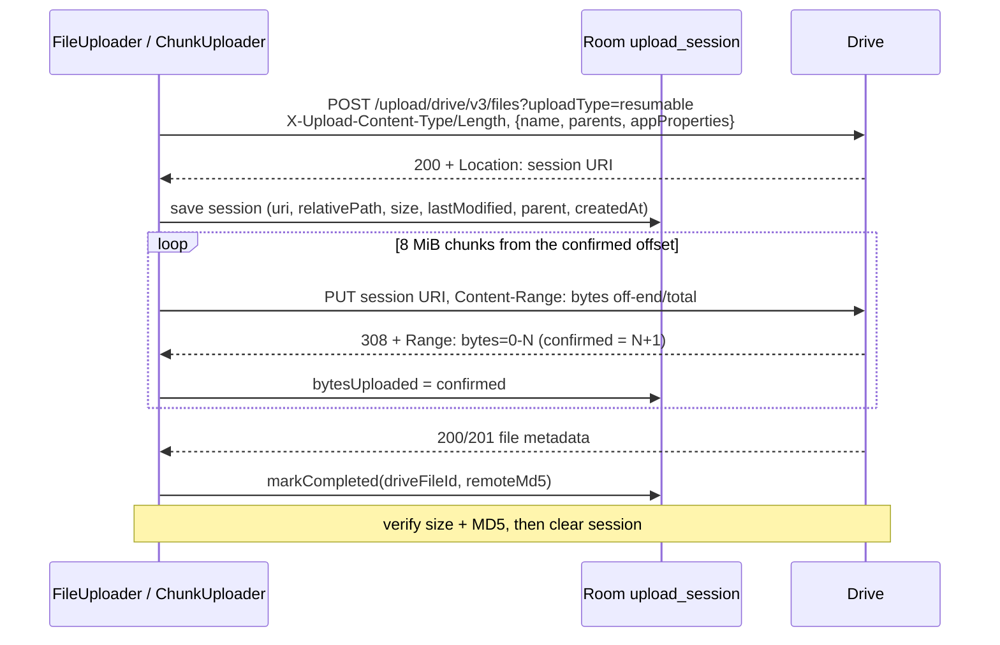

# Implementation Guide: the upload pipeline

This document walks through how one backup run works, from WorkManager down to individual HTTP
requests. Paths are relative to `app/src/main/java/com/johnsonyuen/signalbackup/`. For setup and the
feature overview see `README.md`; for agent rules and the package map see `CLAUDE.md`.

## 1. Scheduling (`work/`, `worker/`)

`UploadSchedulerImpl` owns all upload work:

- **Daily run:** unique periodic work `signal_backup_daily`, 24 h interval with a 2 h flex window.
  Constraints are network (`UNMETERED` when "Wi-Fi only" is on, otherwise `CONNECTED`) and battery
  not low. The first run is placed at the chosen wall-clock time with `DailySchedule.nextRun`
  (`ZonedDateTime`, DST-aware), using both `setInitialDelay` and `setNextScheduleTimeOverride` so the
  flex window can't push it later. The work is tagged `schedule:HH:MM@<zone>`.
- **`applySchedule()`** runs on app start (`SignalBackupApp.onCreate`) and whenever schedule, Wi-Fi or
  setup state changes. It cancels the old work names from previous app versions, cancels the periodic
  work if scheduling is off or setup is incomplete, keeps the current timing with policy `UPDATE` when
  the tag (time + zone) is unchanged, and re-enqueues pinned to the new time otherwise, without
  interrupting a run that is in progress.
- **After every scheduled run** the worker calls `onScheduledRunFinished()`, which re-pins the next
  run to the chosen time so it doesn't drift by the flex window.
- **Manual run:** unique one-time work `signal_backup_manual`, expedited
  (`RUN_AS_NON_EXPEDITED_WORK_REQUEST` when out of quota), policy `KEEP`, so tapping twice is a no-op.
- Both use **exponential backoff starting at 15 min**.

`UploadWorker.doWork()`:

1. Promotes itself to a `dataSync` foreground service with a progress notification. If that fails on
   a manual run it returns `retry()`; a scheduled run continues in the background.
2. Takes a Wi-Fi lock (high-perf) and a partial wake lock (4 h cap), released in `finally`.
3. Calls `PerformUploadUseCase` with a progress listener. Progress goes to `UploadProgressTracker`
   for the UI, and to the notification at most once a second.
4. Maps the result:

| `UploadResult` | Worker result | Side effects |
|---|---|---|
| `Success` | success | clear problem notifications |
| `NoNewBackup` | success | "stale" notification |
| `NeedsConsent` | failure | consent notification (+ stale warning if last success > 36 h) |
| `WaitingForWifi` | retry | — |
| `Failed`, retryable, attempts < 5 | retry | — |
| `Failed`, otherwise | failure | failure notification with a fix action (+ stale warning if last success > 36 h) |
| `AlreadyRunning` | success | — |

Scheduled runs call `onScheduledRunFinished()` on every terminal outcome. On Android 15+ the dataSync
foreground time limit can stop the worker; the stop reason is logged and the next attempt resumes the
persisted session.

## 2. One run (`domain/usecase/PerformUploadUseCase.kt`)

`PerformUploadUseCase` is a `@Singleton` with a **process-wide `Mutex`** in its companion object.
`tryLock()` failing returns `AlreadyRunning` immediately, with no history row. Otherwise:

1. Read settings. If there's no account → `Failed(NOT_SIGNED_IN)`; no local folder → `Failed(LOCAL_FOLDER_NOT_SET)`.
2. `NetworkPolicy.ensureUploadAllowed()`: with Wi-Fi only on, a metered or missing network throws
   `WifiRequiredException` → `WaitingForWifi`.
3. `ResolveDriveFolderUseCase` (section 6).
4. `BackupFolderScanner.scan()` (section 3). No backup item → `Failed(NO_BACKUP_FOUND)`.
5. `MirrorSyncer.sync()` (section 4).
6. Staleness (section 5) → `NoNewBackup`, else `Success(newestName, bytesUploaded, filesUploaded)`.

Exceptions are mapped by `mapFailure()` to a `FailureReason` and a short message that is safe to show
the user (quota exceeded, Drive 404, retryable 5xx/429, checksum mismatch, local read error, network, …).
Each `FailureReason` has a `retryable` flag. Then **exactly one** `upload_history` row is written
under `NonCancellable` (status SUCCESS / STALE / FAILED, failure reason, message, bytes uploaded,
newest backup name and size, Drive file id and MD5 for successful legacy-file runs). Notes such as
"Drive folder was recreated" or "N file(s) changed during upload" are appended to the message.

## 3. Scanning the local folder (`domain/mirror/BackupFolderScanner.kt`)

- Requires a persisted read permission on the SAF tree URI; otherwise `LocalFolderInaccessibleException`.
- Breadth-first walk, one `DocumentsContract` children query per directory (`DocumentTreeSource`).
  A root that can't be listed → inaccessible; a subfolder that can't be listed → `LocalReadException`.
- Skips hidden entries (leading `.`), `*.tmp`, `*.partial`, and files modified less than 2 minutes ago.
  Every visited path, including skipped ones, goes into `presentPaths`, which Clean Up uses.
- **Backup items** are recognised at the top level only (`BackupNames`):
  - legacy file `signal-*.backup`
  - snapshot folder `signal-backup-*` (only if it contains eligible files)

  Each item's time is the `YYYY-MM-DD-HH-MM-SS` in its name, read in the device zone, falling back to
  lastModified. The newest item determines staleness and the history row.

## 4. Mirroring (`domain/mirror/MirrorSyncer.kt`)

1. Load all `synced_file` rows. List the Drive root folder's children. Any top-level record whose
   Drive id is no longer in the root (the user deleted it on Drive) is dropped, along with everything
   under it, so it gets mirrored again.
2. **Directories** (parents first): reuse the recorded Drive folder id; otherwise reuse a same-named
   child folder (preferring app-tagged ones); otherwise create a tagged folder. Then record it.
3. **Pending files** are those with no record, or whose size or lastModified differ from the record.
   Upload order: loose files first, then backup items oldest first; inside an item, `manifest.json`
   goes last so a snapshot only looks complete on Drive once everything else is there.
4. For each file:
   - **Adopt** if the Drive parent already has a non-folder child with the same name and size whose
     `md5Checksum` matches the local MD5. No upload is needed (this picks up older legacy uploads).
   - Otherwise `FileUploader.upload()` (section 7).
   - On success, upsert a `SyncedFile(relativePath, size, lastModified, driveFileId, md5, syncedAt)`.
   - `LocalFileChangedException` (Signal is still writing) skips the file for this run and counts it
     in `filesSkipped`. That item's `manifest.json` is then deferred too.
   - Any other exception aborts the pass. Rows already written stay, so the next run continues where
     this one stopped.
5. Progress is reported as bytes across all pending files, with the current file name.

## 5. Staleness (`domain/mirror/Staleness.kt`)

If the newest local backup item is more than **48 h** old, the run still mirrors everything, then
returns `NoNewBackup` (history status STALE) and the worker posts a "Signal hasn't made a new
backup" notification. Separately, the worker warns after a failed run when the last *successful*
history row is more than 36 h old.

## 6. Drive folder and auth

- **Auth:** sign-in is Credential Manager (`GetSignInWithGoogleOption` with `BuildConfig.WEB_CLIENT_ID`)
  and only stores the email. `DriveAuthorizerImpl` calls Play services `AuthorizationClient.authorize`
  for `drive.file` on that account. In the background a needed resolution throws
  `NeedsConsentException`; the UI (`ui/consent/DriveAuthorizationFlow`) launches the consent
  PendingIntent. `DriveRepositoryImpl` sends `Authorization: Bearer <token>`; on a 401 it clears the
  cached token and retries once.
- **`ResolveDriveFolderUseCase`:** if a folder is configured and `files.get` returns it (not trashed,
  is a folder), use it and sync its name. Otherwise create a tagged "Signal Backup" folder in My Drive,
  save it, clear `synced_file` and the upload session, and return `Relocated`. Under `drive.file` a
  folder the app didn't create returns 404, which is why this exists.
- Everything created (folders, resumable and multipart uploads) carries `appProperties
  {signalBackup: "1"}`, exposed as `DriveFileMeta.uploadedByApp`.

## 7. Uploading one file (`domain/upload/FileUploader.kt`)

`upload(file, parentId, onProgress)`:

1. `NetworkPolicy.ensureUploadAllowed()`, then `ensureUnchanged(file)`: re-stat the SAF document and
   throw `LocalFileChangedException` if size or lastModified differ from the scan.
2. **Files under 5 MiB:** read fully into memory (checking the exact length), compute the MD5, and send
   one `uploadType=multipart` request, then verify. The resumable session is not used.
3. **Larger files:** look at the persisted `upload_session` row (one at a time). It is resumed only if
   relativePath, size, local lastModified and Drive parent all match, it is less than 6 days old
   (unless the upload already completed), and it has fewer than 3 failed resumes. Otherwise it is
   discarded and a fresh session started.

### Resumable protocol

**Fresh session:** `initiateResumableUpload`, save the session row, stream chunks from offset 0 while
feeding a `StreamingMd5`. If the session expires mid-upload, one fresh restart is allowed.

**Resume:**
- If the session already has a `driveFileId` (completed but not verified, e.g. killed during
  verification), `files.get` it and verify. If it's gone, start fresh.
- Otherwise query with `PUT` + `Content-Range: bytes */total`:
  - `308` → continue from the confirmed offset
  - `200/201` → completed, verify
  - `404/410` → expired, start fresh

  Each resume failure caused by an IOException increments `failureCount`; after 3 the session is
  abandoned.

### Chunks and re-seeking (`ChunkUploader`)

- Chunk size is 8 MiB (32 × 256 KiB; Drive requires multiples of 256 KiB except for the last chunk).
- **Drive's confirmed offset is the source of truth.** A `308` may confirm fewer bytes than were sent.
  The next chunk always starts at `confirmed` (the reader seeks there), not at `offset + length`.
  An invalid range fails the upload. Three chunks in a row with no progress abort it.
- **Per-chunk retry:** a network error or retryable HTTP status (5xx, 429, 408, 403 rate-limit) backs
  off exponentially with jitter (1 s, 2 s, 4 s … capped at 60 s, up to 6 attempts), then *queries*
  the session before resending. If Drive's offset moved, it re-seeks instead of resending. A 404/410
  means the session expired.
- Every confirmed offset is persisted (`updateBytesUploaded`) and reported for progress.
- Every 4 chunks it re-checks the Wi-Fi policy and that the local file hasn't changed.
- The Drive file id is stored as soon as Drive answers 200/201, before verification.
- `StreamingMd5` hashes each byte once, so re-sending after a backwards re-seek is harmless. A resumed
  upload (gap at the start) falls back to re-hashing the whole file.

### Verification (`UploadVerifier`)

1. Re-stat the local file. If it changed, trash the remote copy and throw `LocalFileChangedException`.
2. Compare the remote size with the local size. If Drive hasn't reported the MD5 or size yet, re-fetch
   up to 3 times (2 s, 4 s, 6 s apart).
3. Compare the remote `md5Checksum` with the local MD5 (case-insensitive). If Drive never reports an
   MD5, the file is accepted on size alone (logged).
4. On a mismatch, trash the remote file, clear the session and throw `ChecksumMismatchException`
   (retryable).
5. On success, clear the session and return `VerifiedUpload(meta, md5, bytesSent)`.

## 8. Clean Up (`domain/usecase/GarbageCollectUseCase.kt`)

`scan()` needs a configured Drive folder and a readable local folder (otherwise `Blocked` or
`NothingToClean`). It lists backup items at the top of the Drive folder, newest first by name
timestamp. If the newest isn't in `synced_file` or in successful history, the result is `Blocked`.
It keeps the newest 3 items. Candidates are:

- (a) `synced_file` records whose path is no longer present locally (excluding the kept items and
  their contents; children of a trashed folder are covered by the folder), and
- (b) older top-level legacy `.backup` files not present locally that the app uploaded (tag,
  successful history, or `synced_file`).

`trash()` moves each item to the Drive trash (`trashed: true`; a 404 counts as already gone), removes
the matching `synced_file` rows (including descendants), and carries on past individual failures.

## 9. Database (Room v5, `data/local/`)

| Table | Purpose |
|---|---|
| `app_settings` | single row id=1: folders, schedule, account email, theme, Wi-Fi only |
| `upload_history` | one row per run: status, failureReason, message, bytesUploaded, md5Checksum, … |
| `upload_session` | single in-flight resumable upload (section 7) |
| `synced_file` | mirrored files/folders keyed by `relativePath` |

`DatabaseMigrations` migrates every older schema (v1–v4) to v5, keeping settings and history. The
v4→v5 migration rebuilds `app_settings` and `upload_history` via `_v5` temp tables and copies the rows
across. Only the obsolete retry and resume columns are dropped, so an in-flight session from the old
version is discarded. There is no
destructive fallback. `DatabaseMigrationTest` covers each starting version (including hand-built
variants of v2/v3). Any new version needs a migration and tests of its own. Schemas are exported to
`app/schemas/` (uploaded as a CI artifact).

## 10. Testing

Unit tests live in `app/src/test/java/com/johnsonyuen/signalbackup/`, organised by package:

- upload engine: `FileUploaderTest`, `UploadHelpersTest` with fakes in `UploadFakes.kt`
- mirror: `MirrorSyncerTest`, `BackupFolderScannerTest`
- use cases: `PerformUploadUseCaseTest`, `GarbageCollectUseCaseTest`, `ResolveDriveFolderUseCaseTest`
- Drive client: `DriveRepositoryImplTest`
- worker and scheduling: `UploadWorkerTest`, `DailyScheduleTest`, `UploadSchedulerImplTest`
- data and UI: database migrations, repositories, ViewModels

Time-dependent code takes an injected `Clock`, so tests use fixed clocks. Run them with
`./gradlew testDebugUnitTest`.
