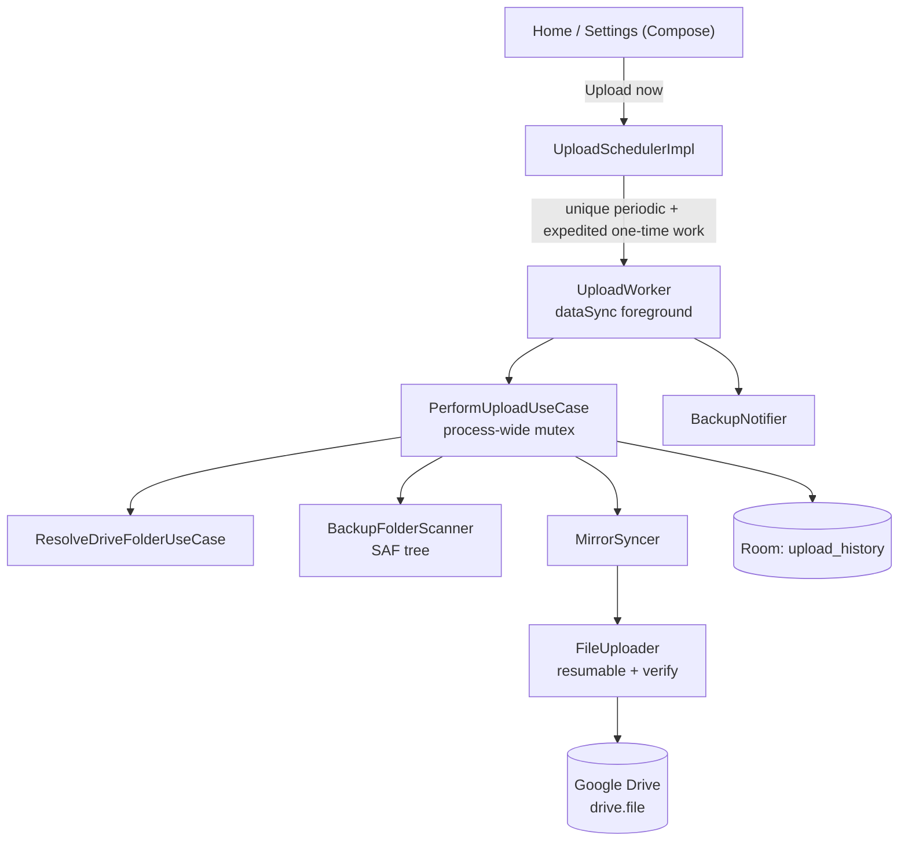

# Signal Backup

An Android app that copies Signal's on-device backups to Google Drive once a day.

Signal can write backups to a folder on your phone but does not upload them anywhere. This app mirrors
that folder into a folder in your Google Drive, verifies every upload, and tells you when something
goes wrong or when Signal stops producing new backups.

## What it does

- **Mirrors the selected folder.** The app copies the whole folder tree you pick (via the Storage
  Access Framework) into the Drive folder, keeping the same relative paths; subfolders become Drive
  folders. It handles both backup formats:
  - newer Signal versions write snapshot folders (`signal-backup-YYYY-MM-DD-HH-MM-SS/` containing
    `backup.db`, `attachments/`, `manifest.json`, …);
  - older versions write single files (`signal-YYYY-MM-DD-HH-MM-SS.backup`).
- **Uploads each file once.** Uploaded files are recorded (path, size, last-modified) and only
  re-uploaded if they change. Hidden files, `*.tmp`, `*.partial` and files modified in the last
  2 minutes (still being written) are skipped. A file already on Drive with the same name, size and
  MD5 is adopted instead of re-uploaded. Inside a snapshot, `manifest.json` is uploaded last.
- **Resumable, verified uploads.** Files of 5 MiB or more use Drive's resumable protocol in 8 MiB
  chunks; progress survives app kills and retries. After upload the size and MD5 are checked against
  the local file; a mismatched copy is moved to the Drive trash and retried.
- **Daily schedule.** A WorkManager periodic job runs once a day at about the time you choose
  (2-hour flex window; requires a network, Wi-Fi if "Wi-Fi only" is on, and battery not low).
  "Upload now" queues an expedited one-off run. Only one run happens at a time.
- **History and notifications.** Every run is logged (success, failed with a reason, or "no new
  backup"). Failures that won't fix themselves post a notification with a button that takes you to
  the fix (sign in, grant Drive access, choose folder, …). You are also notified when the newest
  local backup is more than 48 hours old, or when a run fails and the last successful backup is
  more than 36 hours old.
- **Clean Up (manual).** Nothing is ever deleted from Drive automatically. "Clean up old backups"
  scans Drive and, after you confirm, moves to the **Drive trash** (restorable for 30 days):
  - mirrored items whose local copy Signal has since deleted, and
  - older legacy `signal-*.backup` files at the top of the Drive folder that this app uploaded.

  Safety rules: it always keeps the 3 newest backup items, never touches anything still present
  locally, and refuses to run unless the newest backup on Drive has been verified by this app (and
  the local folder is readable). Items are trashed, never permanently deleted.
- **Limited Drive access.** The app uses the `drive.file` scope, so it can only see files and folders
  it created. On first run (or if the configured folder is no longer accessible) it creates a folder
  named **"Signal Backup"** in My Drive and uses it. The in-app folder picker only lists folders the
  app created and can create new ones.
- **Sign-out** revokes Drive access, cancels scheduled work, and forgets the account, the selected
  folders and upload state. Backups already on Drive are kept.

## Using the app

1. **Turn on on-device backups in Signal** (Signal › Settings › Chats › Backups) and note the folder
   Signal writes to.
2. **Install the APK** from the repository's
   [GitHub Releases](https://github.com/johnsonjsyuen/SignalBackup/releases) page
   (`SignalBackup-<version>.apk`, with `SHA256SUMS.txt` and a build-provenance attestation). You
   need to allow installing apps from your browser or file manager.
3. Open the app and **sign in with Google**, then **allow Google Drive access** on the consent
   screen that follows.
4. **Choose Signal's backup folder** (the folder itself, so the app can read everything in it).
5. In **Settings** set the backup time, Wi-Fi only, and theme, and grant the permissions listed there:
   - **Notifications** (Android 13+), so you hear about failures;
   - **Battery optimization**: allow background activity so the daily job isn't delayed;
   - **Pause app activity if unused**: turn this off so Android doesn't stop backups when you rarely
     open the app.
6. Tap **Upload now** once to check everything works. The Home tab shows progress, the last result
   and the next scheduled run; the History tab lists every run.

The first upload of a large backup can take a while. On Android 15+ a single `dataSync` foreground
session is time-limited; if it is stopped, the next attempt resumes where it left off.

## Developer setup

### Requirements

- JDK 21 (CI uses Temurin 21). The Gradle wrapper (Gradle 9.8.1) is included.
- Android SDK with platform 37 installed (compileSdk 37, targetSdk 36, minSdk 26).

### Google Cloud project

Sign-in and Drive access need OAuth clients in a Google Cloud project you control:

1. In the [Google Cloud Console](https://console.cloud.google.com/) create a project.
2. **Enable the Google Drive API** (APIs & Services › Library).
3. Configure the **OAuth consent screen** (Google Auth Platform): external user type, app name and
   support email, and add the scope `https://www.googleapis.com/auth/drive.file`. While the app is in
   "Testing", **add your Google account as a test user**, or sign-in/consent will fail.
4. Create a **Web application** OAuth client. Its client ID is passed to Credential Manager
   ("Sign in with Google"). Put it in `local.properties` (not committed) or pass it as a Gradle property:

   ```properties
   # local.properties
   signalbackup.webClientId=1234567890-abc.apps.googleusercontent.com
   ```

   or `./gradlew assembleDebug -Psignalbackup.webClientId=...`. If unset, the build falls back to
   the ID hard-coded in `app/build.gradle.kts`, which belongs to the maintainer's project and won't
   work with your signing keys.
5. Create **Android** OAuth clients for package `com.johnsonyuen.signalbackup`, one per signing key,
   with that key's SHA-1. Play services' `AuthorizationClient` uses these to issue Drive tokens.

   ```bash
   # debug key
   keytool -list -v -keystore ~/.android/debug.keystore -alias androiddebugkey -storepass android -keypass android
   # release key
   keytool -list -v -keystore release.jks -alias <alias>
   ```

### Build and test

```bash
./gradlew assembleDebug          # debug APK
./gradlew testDebugUnitTest      # JVM unit tests (JUnit4, Robolectric, MockK, Turbine)
./gradlew lintDebug              # Android Lint (abortOnError)
./gradlew assembleRelease        # release APK; signed only if KEYSTORE_FILE etc. are set
```

Release signing reads `KEYSTORE_FILE`, `KEYSTORE_PASSWORD`, `KEY_ALIAS` and `KEY_PASSWORD` from the
environment; without `KEYSTORE_FILE` the release APK is unsigned. Version name/code default to
`1.0`/`1` and can be overridden with `-PversionName=` / `-PversionCode=` (CI derives them from the
tag). See [CI_CD_GUIDE.md](CI_CD_GUIDE.md) for workflows and releases, and
[IMPLEMENTATION_GUIDE.md](IMPLEMENTATION_GUIDE.md) for how the upload pipeline works.

## Architecture

Single-module app: Jetpack Compose UI with ViewModels, Hilt DI, Room for state, WorkManager for
background runs, and a small Drive v3 REST client built on google-http-client.



## Tech stack

| Area | Library (version from `gradle/libs.versions.toml`) |
|---|---|
| Build | AGP 9.4.0 (built-in Kotlin), Kotlin 2.4.21, KSP 2.3.11, Gradle 9.8.1 |
| UI | Jetpack Compose (BOM 2026.09.00), Material 3, Navigation Compose 2.10.2 |
| DI | Hilt 2.60.1, AndroidX Hilt 1.4.0 |
| Background | WorkManager 2.12.0 |
| Storage | Room 2.8.5 (schema v5) |
| Drive | google-api-client-android 2.9.1, google-api-services-drive v3-rev20261011-2.0.0 |
| Auth | Credential Manager 1.6.0 + googleid 1.2.1 (sign-in), play-services-auth 21.6.0 `AuthorizationClient` (Drive scope) |
| Files | AndroidX DocumentFile 1.1.0 / SAF |
| Async | Kotlin Coroutines 1.11.0, kotlinx.serialization 1.11.0 |
| Tests | JUnit 4.13.2, MockK 1.14.11, Turbine 1.2.1, Robolectric 4.17, work-testing, room-testing |

## License

There is no licence file yet; the owner hasn't chosen a licence.
